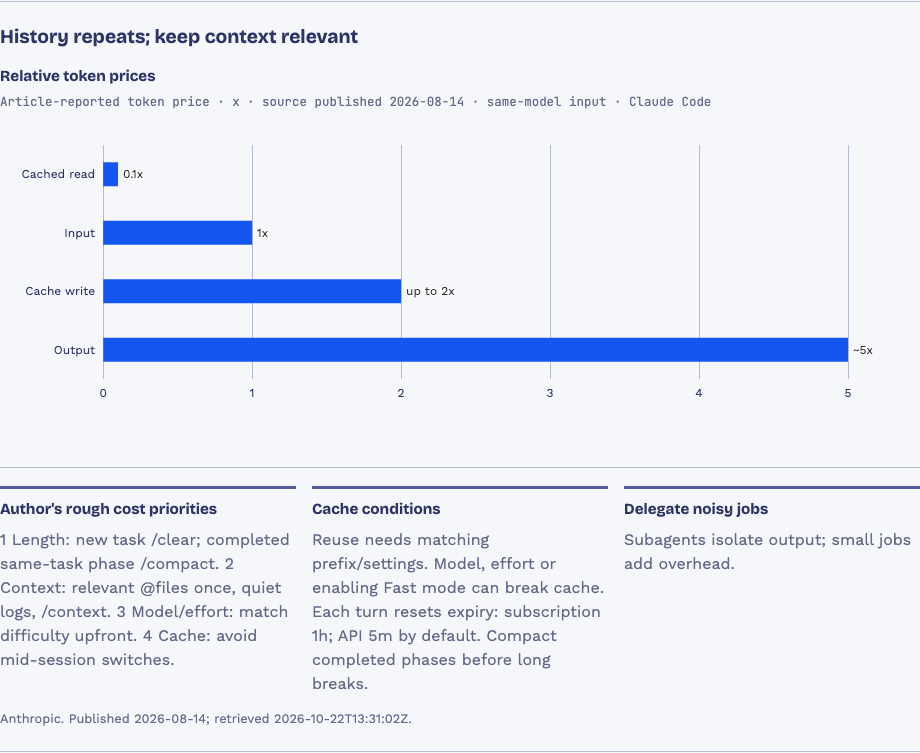

# Claude Code session value: English HTML example

[**Read the rendered brief**](https://bobbyyue.github.io/3080-brief/examples/claude-code-session-value.html) · [HTML file in this repository](claude-code-session-value.html) · [Original article](https://claude.com/resources/articles/maximizing-the-value-of-your-claude-code-sessions)

## About this example

The source is Lydia Hallie's *Maximizing the value of your Claude Code sessions*, published by Anthropic on August 14, 2026 and retrieved on October 22, 2026. The source remains unchanged; the linked page is a separate English synopsis.

This example was regenerated with the current installed 3080 Brief on October 22, 2026, using configuration revision **33**. It uses the skill's HTML composer, an embedded interactive chart, and a native SVG fallback. Example-specific rendering fixes keep mobile table values together and make annotations and the fallback readable. It can be read online or opened locally without network dependencies.

The README preview is a screenshot of the new page's main figure, not a mockup or the old example. Both language editions link to this same English HTML. A header-contrast correction on October 23 left the content unchanged.

## Scope and verification

- Product behavior and price ratios are attributed to the dated source, not presented as independently verified current tariffs or measured savings.
- Detailed command options remain in the original article; this is a compact brief, not a replacement manual.
- [Generation record](claude-code-session-value.provenance.json) identifies the generator snapshot and published HTML checksum.
- This update changes the READMEs and example only. It does not change the installable skill package or create a new release tag.

## Embedded asset licenses

The generated page embeds Apache ECharts and selected fonts. Their notices remain available in this repository:

- [Apache ECharts license](../../skills/3080-brief/assets/html-kit/licenses/ECHARTS-LICENSE.txt)
- [Bricolage Grotesque font license](../../skills/3080-brief/assets/html-kit/fonts/BricolageGrotesque-OFL.txt)
- [Work Sans font license](../../skills/3080-brief/assets/html-kit/fonts/WorkSans-OFL.txt)
- [JetBrains Mono font license](../../skills/3080-brief/assets/html-kit/fonts/JetBrainsMono-OFL.txt)
- [Theme adaptation license](../../skills/3080-brief/assets/themes/LICENSE.beautiful-feishu-whiteboard.txt)
